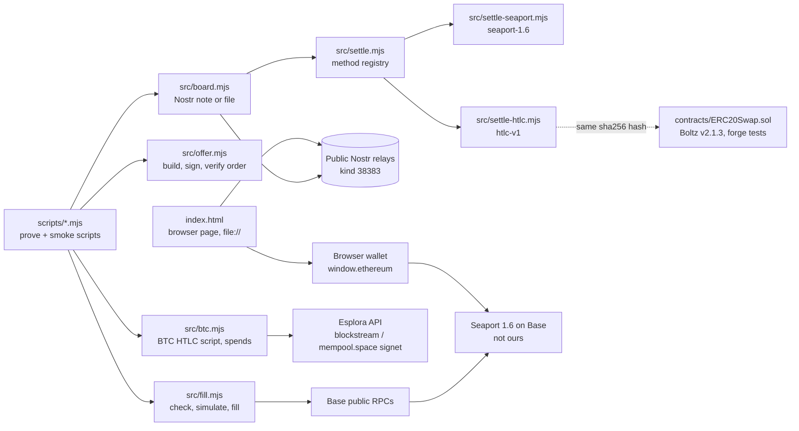
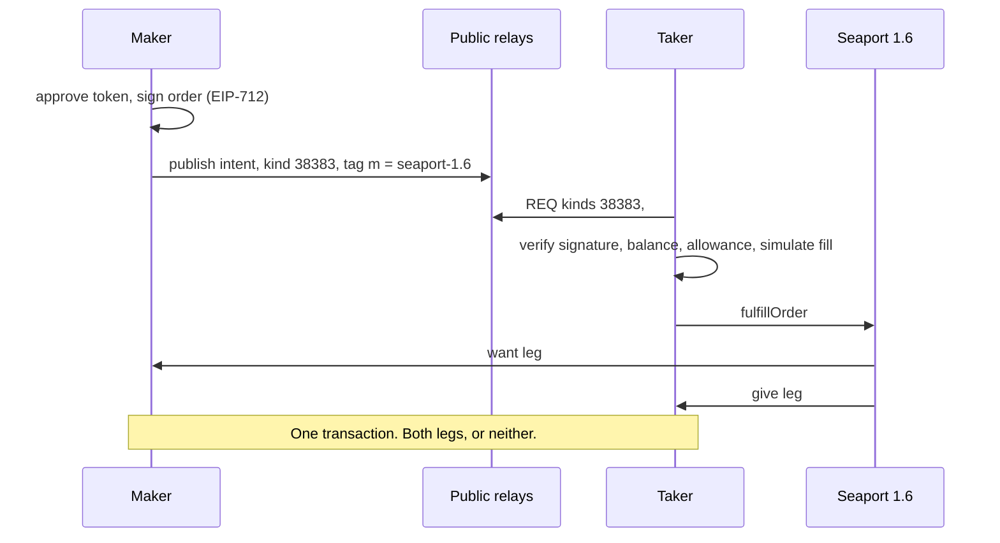
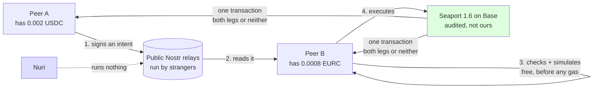
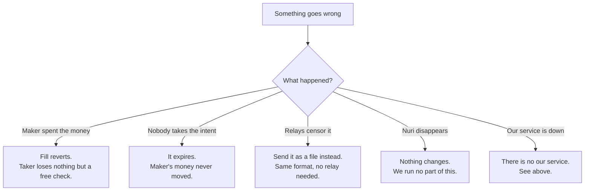

# nuri-p2p

A board where peers post swap intents and other peers fill them. Nobody in the middle.
Intents travel over public Nostr relays (or as a file). ERC-20 swaps on Base settle in one Seaport 1.6 transaction.
For people and agents who want to trade directly, with no operator, no allowlist, no server of ours.

## Logs

- [CHANGELOG.md](CHANGELOG.md): release notes and commit history
- [PROMPTLOG.md](PROMPTLOG.md): rules and prompts that shaped this repo

## Status

| field | value |
|---|---|
| version | v0.1.0 |
| date | 2026-10-14 |
| updated by | hermes-agent for emino |
| default-branch HEAD | `98408a34` (main) |
| deployment | not documented in repo. `index.html` runs from `file://`, no server |
| settlement `seaport-1.6` | works, proven on Base mainnet (`proofs/fill-30cd40bdde.json`) |
| settlement `htlc-v1` | parsed, timelocks enforced, returns `no_adapter_yet` |
| Bitcoin HTLC | proven on signet (`proofs/btc-signet-htlc.json`), not on mainnet |

An intent says what you give and what you want. `settle` names how it settles. Anyone who
understands that method can fill it. No allowlist, no registration, no operator. Today one method
works (two ERC-20 legs on Base, both moved in a single transaction). Bitcoin is the next one, and
adding it does not change the board, the page, or anybody else's client.

## Architecture



## User flow



In the page: "Sign this offer" then "Copy it" (maker). "Look for offers" or paste, "Check it", then "Accept and swap" (taker).

## Components

| component | path | role |
|---|---|---|
| constants | `src/constants.mjs` | chain id 8453, Seaport and token addresses, relays, RPCs, offer kind 38383 |
| offer | `src/offer.mjs` | build Seaport order, EIP-712 sign, order hash, recover signer |
| method registry | `src/settle.mjs` | `register`, `get`, `known`, CAIP-2 chain ids |
| seaport method | `src/settle-seaport.mjs` | `seaport-1.6`: signed order to intent and back |
| htlc method | `src/settle-htlc.mjs` | `htlc-v1`: parse terms, timelock safety rule, `no_adapter_yet` |
| board | `src/board.mjs` | intent to Nostr note and back, `publish`, `fetchIntents`, file format |
| fill | `src/fill.mjs` | RPC connect with fallback, `check`, `simulate`, `fill`, `cancel`, `approve` |
| bitcoin | `src/btc.mjs` | HTLC script and address, claim and refund txs, Esplora client |
| page | `index.html` | the whole product for a person, one file, loads ethers from esm.sh |
| contracts | `contracts/` | Boltz v2.1.3 `ERC20Swap`, `EtherSwap`, `TransferHelper`, `TestERC20` (verbatim) |
| node tests | `test/*.test.mjs` | 67 `node:test` cases; `live.test.mjs` and parts of `fill.test.mjs` read Base |
| forge tests | `test/contracts/ERC20Swap.t.sol` | 9 tests for lock, claim, refund |
| proofs | `proofs/` | JSON evidence: mainnet fill, board publishes, signet HTLC |
| intent spec | `SCHEMA.md` | the intent format, for other implementers |

## API / Endpoints

No HTTP server. Interfaces are npm scripts, CLI scripts, the page and the Nostr event format.

| kind | name | auth / keys | purpose |
|---|---|---|---|
| npm | `npm test` | none | node tests, never spends |
| npm | `npm run test:contracts` | none | `forge test` |
| npm | `npm run check` | none | `node --check` on src files |
| npm | `npm run test:page` | none | build ethers bundle, boot page in headless Chrome, offline |
| npm | `npm run test:live` | none | page against real public relays |
| npm | `npm run prove:board` | none | dry; `--publish` posts an intent from a random key |
| npm | `npm run prove` | `PROVE_MAKER_KEY`, `PROVE_TAKER_KEY` with `--execute` | one real swap on Base, writes `proofs/fill-*.json` |
| npm | `npm run prove:stale` | `PROVE_MAKER_KEY`, `PROVE_SINK` with `--execute` | proves a dead offer is refused before gas |
| CLI | `node scripts/prove-btc.mjs` | `SIGNET_KEY` with `--execute` | signet lock, claim, lock, refund |
| page | `index.html` buttons | browser wallet | Sign this offer, Copy it, Check it, Accept and swap, Look for offers |
| Nostr | kind `38383`, tags `m`, `g`, `w` | Nostr signature | intent envelope, see `SCHEMA.md` |

## Run

```sh
npm install
npm test               # 67 node tests, live Base tests skip if no RPC is reachable
npm run test:contracts # 9 forge tests (needs foundry and the lib/ submodules)
npm run test:page      # the page in headless Chrome, offline
npm run test:live      # the page against the real public relays
npm run prove:board    # dry; add --publish to post to public relays
```

Requires Node >= 22 (`package.json` engines). Page tests expect Google Chrome at the macOS app path.
Open `index.html` in a browser with a wallet. It works from `file://`, with no server.

`npm test` can never spend money: it holds no key and sends no transaction. Anything that moves
funds needs an explicit `--execute` and keys you supply.

Env var names read by the code:

| name | read in | use |
|---|---|---|
| `NURI_P2P_RPC` | `src/fill.mjs` | override Base RPC list |
| `RELAYS` | `scripts/prove-board.mjs` | comma-separated relay list |
| `PROVE_MAKER_KEY` | `scripts/prove.mjs`, `scripts/prove-stale.mjs` | maker key for `--execute` |
| `PROVE_TAKER_KEY` | `scripts/prove.mjs` | taker key for `--execute` |
| `PROVE_GIVE`, `PROVE_WANT` | `scripts/prove.mjs` | swap amounts, default 0.01 |
| `PROVE_SINK` | `scripts/prove-stale.mjs` | address that receives the maker's tokens |
| `SIGNET_KEY` | `scripts/prove-btc.mjs` | signet wallet key for `--execute` |

## How it works



The money never leaves a wallet until both sides move at once. There is no step where funds sit
somewhere waiting. So there is nothing to recover, no escrow, no recovery key.

## What happens when things go wrong



## Try it right now

A demo offer was posted to the public board. Offers expire, so an empty board is normal: offers
only exist while somebody makes one.

- Maker `0x42EA1bd1DdAfd2911095BEe9284A400BE9889318` gives **0.0002 USDC**, wants **0.00018 EURC**
- Intent `0x202c157aeebe1d92fe63f519196613feb342c6895e7dd7f791933e8d0c5646f0`
- Find offers: open `index.html`, click "Look for offers", or ask any relay for kind `38383` with tag `m = seaport-1.6`

It is dust on purpose. It proves the loop: sign, publish, discover, check, fill.

## Bitcoin

The Bitcoin half is proven on signet: lock, claim with the secret, and the refund after the
timeout, all as real transactions:

| what | transaction | block |
|---|---|---|
| lock 20000 sats | `0147e2e5b81123e3072844daa38e8d4772861ce5d4f2e36a2245347b6215caf5` | 322193 |
| claim with the secret | `d2503ad9445bc6a1133608e162fc817edad36dfb36c313e761b3499ad999c62f` | 322194 |
| lock again | `e7e2c9aa865405567081c49d9caf2a41148882522a2b32f7af8ae004181fc88f` | 322195 |
| refund after timeout | `83e1836c4a028b853c07cd26dbc5b575dba44184887f9e6d45a592968df6f7da` | 322197 |

Refused along the way, by the network and not by us: a refund before the timeout, and a claim
with the wrong secret.

The claim published the secret on chain (`b7d29d27f54a591308a08378b8736c54bf8213087a70462d36bada920be1c182`),
sitting in the witness for anyone to read. That is the mechanism: the same SHA256 hash locks
`contracts/ERC20Swap.sol` on Base, so revealing the secret to take the Bitcoin also opens the
EVM side. Neither peer can take both.

Still missing: the two halves driven as one swap (planned `scripts/prove-swap.mjs`, not in the
repo yet), and mainnet. Reproduce the Bitcoin half with `node scripts/prove-btc.mjs`. It costs
nothing and broadcasts nothing until `--execute`.

## The page

`index.html` is the frontend, one file, no build, no server. Open it from `file://` in any
browser with a wallet. It makes offers, checks other people's offers in plain sentences, and
executes them. It talks to Base and to public relays, never to a server of ours.

## Why not just use CoW

CoW has the better price and the better auction. But its settlement contract is `onlySolver`: a
peer cannot fill a peer's order, and joining the solver set means a pool plus onboarding. NEAR
Intents needs approval and KYC/KYB. Those are venues you send an order *to*.

This is the other thing: peers meeting directly, any taker, no permission. If you want the best
price on an EVM pair, use CoW. If you want two people, or two agents, to trade without asking
anyone, use this.

## The one rule

A settlement method is listed here if and only if **any taker can fill it**. That is what rules
out CoW (`onlySolver`) and NEAR (KYC). Methods register themselves in one file; the board never
parses their terms.

| method | legs | atomic | status |
|---|---|---|---|
| `seaport-1.6` | ERC-20 to ERC-20 on Base | yes, one transaction | works, proven on mainnet |
| `htlc-v1` | Bitcoin / Lightning to EVM | two locks, one secret | readable, `no_adapter_yet` |

## What is proven, and what is not

| claim | evidence |
|---|---|
| a real swap settles | **proven live**: Base mainnet, fill `0xe52248be…fee9476`, block 51271640, status 1. Maker 2000 USDC units to 800 EURC units, taker the reverse. Proof: `proofs/fill-30cd40bdde.json` |
| the board carries intents without us | **proven live**: published to three public relays, read back by a fresh client, signature and both legs intact (`proofs/board-*.json`) |
| a stranger's client can read them | **proven live**: 20 lines of WebSocket, no code of ours |
| the shipped page finds real intents | **proven live**: headless Chrome, real relays, two intents listed |
| a worthless offer costs the taker nothing | **proven live**: refused against Base before any gas |
| our order hash is what Seaport computes | **proven live**: asserted against `getOrderHash` on Base (`test/live.test.mjs`) |
| Bitcoin HTLC lock, claim, refund | **proven on signet**: `proofs/btc-signet-htlc.json` |
| Bitcoin to EVM swap end to end | **not yet**: `htlc-v1` parses and enforces timelocks, no adapter |

Verify the swap yourself:

```sh
cast receipt 0xe52248bee6a4e61f1162469102683a42db42abc9428595ad83379dc13fee9476 status --rpc-url https://base.drpc.org
```

## Layout

```
src/constants.mjs        addresses and values we depend on, all verified on chain
src/offer.mjs            build, sign and verify an offer
src/settle.mjs           the method registry: what settles, and by what rules
src/settle-seaport.mjs   the working method (Base, atomic)
src/settle-htlc.mjs      the Bitcoin method (parses, not executable yet)
src/board.mjs            publish and read intents over Nostr, or as a file
src/fill.mjs             check, simulate and execute a fill
src/btc.mjs              Bitcoin HTLC script, claim/refund spends, Esplora client
index.html               the whole product for a person, one file, works from file://
contracts/               Boltz v2.1.3 HTLC contracts, copied verbatim (see contracts/README.md)
test/                    67 node tests, plus 9 forge tests in test/contracts/
scripts/prove.mjs        one real swap, end to end, writes a proof
scripts/prove-board.mjs  publishes an intent to public relays, reads it back
scripts/prove-stale.mjs  proves a dead offer costs the taker nothing
scripts/prove-btc.mjs    signet HTLC lock, claim, refund
scripts/page-*.mjs       headless Chrome checks of index.html
proofs/                  evidence with transaction and event ids
SCHEMA.md                the intent format, so others can implement it
CONTRIBUTING.md          checks to run before pushing, and the rules
```
